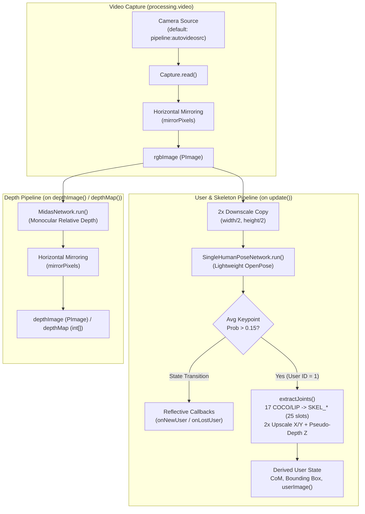

# SimpleOpenEyes Architecture

**SimpleOpenEyes** is a Processing 4 library that provides a drop-in, RGB-camera-based replacement for [SimpleOpenNI](https://github.com/tot-eng/SimpleOpenNI). Instead of relying on legacy OpenNI/NiTE drivers and dedicated depth hardware (such as Kinect or Primesense sensors), it uses standard video capture (`processing.video`) and deep neural networks via [deep-vision-processing](https://github.com/n1ckfg/deep-vision-processing) (built on JavaCV and OpenCV DNN) to perform human pose tracking and monocular depth estimation.

---

## 1. Design Goals

1. **Source-Level API Compatibility**: Expose the `SimpleOpenNI` package namespace, `SimpleOpenNIConstants` joint/node identifiers, and familiar lifecycle methods (`enableRGB()`, `enableDepth()`, `enableUser()`, `update()`, `getJointPositionSkeleton()`, etc.) so legacy Processing sketches can migrate with minimal code changes.
2. **Hardware Independence**: Eliminate native OpenNI/NiTE dependencies and specialized IR/depth sensors in favor of any camera supported by GStreamer / V4L2 / libcamera.
3. **Zero-Calibration Tracking**: Replace OpenNI's "Psi-pose" skeleton calibration workflow with immediate, single-frame neural pose estimation and automatic user detection callbacks.

---

## 2. High-Level Data Flow



---

## 3. Repository Structure

The repository is structured directly as a Processing library package alongside its source and build directories:

```text
SimpleOpenEyes/
├── library.properties                              # Processing library manifest (v1.0.0)
├── README.md                                       # Quickstart and compatibility overview
├── ARCHITECTURE.md                                 # Architectural documentation
├── library/
│   └── SimpleOpenEyes.jar                          # Compiled Processing library archive
├── build/
│   └── SimpleOpenNI/
│       ├── SimpleOpenEyes.class                    # Compiled core class
│       └── SimpleOpenNIConstants.class             # Compiled constants interface
├── SimpleOpenEyes/
│   └── src/
│       └── SimpleOpenNI/
│           ├── SimpleOpenEyes.java                 # Core runtime, capture, DNN & API facade
│           └── SimpleOpenNIConstants.java          # OpenNI-compatible constants
└── examples/
    ├── DepthViewer/
    │   └── DepthViewer.pde                         # Monocular MiDaS depth visualization sketch
    └── SkeletonTracking/
        └── SkeletonTracking.pde                    # 2D skeleton tracking sketch
```

---

## 4. Core Components

### 4.1 `SimpleOpenNI.SimpleOpenNIConstants`
An interface defining integer constants identical to OpenNI's `XnSkeletonJoint` and node enumerations:
- **Skeleton Joint IDs (`SKEL_*`)**: `SKEL_HEAD` (`1`) through `SKEL_RIGHT_FOOT` (`24`), bounded by `SKEL_COUNT` (`25`). Note that indices follow OpenNI's sparse numbering (e.g., `4`, `5`, `8`, `11`, `14`, `19`, `23` are unused).
- **Gesture / Node / Mode Constants**: `GESTURE_*`, `NODE_*`, `IMG_MODE_*`, and `RUN_MODE_*` constants preserved so legacy sketches compile without modification.

### 4.2 `SimpleOpenNI.SimpleOpenEyes`
The primary facade and runtime engine implementing `SimpleOpenNIConstants`. It manages four responsibilities:
1. **Sketch Integration & Lifecycle**: Registers `dispose()` with the host `PApplet` and discovers user event callbacks (`onNewUser`, `onLostUser`, `onStartCalibration`, `onEndCalibration`, `onStartPose`, `onEndPose`) via Java reflection.
2. **Camera Management**: Wraps `processing.video.Capture` with a configurable GStreamer pipeline string (`cameraDevice`, defaulting to `"pipeline:autovideosrc"`) and optional in-place horizontal pixel flipping (`mirror = true` by default).
3. **Deep Vision Inference**: Instantiates `DeepVision` on construction and initializes `SingleHumanPoseNetwork` and (optionally) `MidasNetwork` during `init()`.
4. **State & Coordinate Projection**: Maintains per-frame `PVector[25]` joint coordinates, `float[25]` confidence scores, user tracking status (`trackingUserId`), and synthetic user segmentation masks.

---

## 5. Subsystems and Processing Pipelines

### 5.1 Initialization (`init()`)
Configuration methods (`enableRGB()`, `enableDepth()`, `enableUser()`, `setCameraPipeline()`) set internal flags prior to `init()`. When `init()` is called:
- **Pose Network**: `vision.createSingleHumanPoseEstimation()` is always created and set up as the core tracking backbone.
- **Depth Network**: `vision.createMidasNetwork()` is created and set up only if `enableDepth()` was called.
- **Capture Device**: If any stream (`rgbEnabled`, `depthEnabled`, or `userEnabled`) is active, `new Capture(parent, cameraDevice)` is started.
- **Joint Buffers**: Pre-allocates `joints` (`PVector[SKEL_COUNT]`) and `jointConfidence` (`float[SKEL_COUNT]`).

### 5.2 Frame Capture and Pose Update (`update()`)
Called once per Processing `draw()` loop:
1. **Frame Ingestion**: If a new camera frame is available (`cam.available()`), it is read into `cam`. If `mirror` is enabled, `mirrorPixels(cam)` swaps pixels horizontally in-place. `rgbImage` references `cam`.
2. **Pose Inference** (when `userEnabled` is `true`):
   - Creates a half-resolution copy of `rgbImage` (`width / 2`, `height / 2`) to accelerate inference, since the underlying OpenPose network operates on a fixed small input tensor (`288x384`) and heatmap post-processing scales with input image dimensions.
   - Runs `poseNet.run(poseInput)` to obtain a `HumanPoseResult` containing 17 keypoints.
3. **Person Presence & Callbacks**:
   - `hasConfidentPerson()` computes the mean probability across all 17 keypoints. A mean score `> 0.15f` indicates an active user (`userId = 1`).
   - Transitions between no user (`-1`) and tracked user (`1`) trigger `onNewUser(parent, 1)` or `onLostUser(parent, 1)` via reflection (supporting both 1-parameter `(int userId)` and legacy 2-parameter `(int userId, intperm)` signatures).

### 5.3 Keypoint-to-Skeleton Mapping (`extractJoints()`)
`SingleHumanPoseNetwork` outputs 17 keypoints in COCO / LIP order. `SimpleOpenEyes` maps them into OpenNI's `SKEL_*` slots and synthesizes missing axial joints (`SKEL_NECK` and `SKEL_TORSO`) by averaging surrounding keypoints via `mid()`:

| OpenNI Constant | ID | Source Keypoint(s) in `HumanPoseResult` |
| :--- | :--- | :--- |
| `SKEL_HEAD` | `1` | `kps[0]` (Nose) |
| `SKEL_NECK` | `2` | Midpoint of `kps[3]` (L Ear), `kps[4]` (R Ear), `kps[0]` (Nose) |
| `SKEL_TORSO` | `3` | Midpoint of `kps[11]` (L Hip), `kps[12]` (R Hip), `kps[5]` (L Shoulder), `kps[6]` (R Shoulder) |
| `SKEL_LEFT_SHOULDER` | `6` | `kps[5]` (Left Shoulder) |
| `SKEL_RIGHT_SHOULDER` | `12` | `kps[6]` (Right Shoulder) |
| `SKEL_LEFT_ELBOW` | `7` | `kps[7]` (Left Elbow) |
| `SKEL_RIGHT_ELBOW` | `13` | `kps[8]` (Right Elbow) |
| `SKEL_LEFT_HAND` | `9` | `kps[9]` (Left Wrist) |
| `SKEL_RIGHT_HAND` | `15` | `kps[10]` (Right Wrist) |
| `SKEL_LEFT_HIP` | `17` | `kps[11]` (Left Hip) |
| `SKEL_RIGHT_HIP` | `21` | `kps[12]` (Right Hip) |
| `SKEL_LEFT_KNEE` | `18` | `kps[13]` (Left Knee) |
| `SKEL_RIGHT_KNEE` | `22` | `kps[14]` (Right Knee) |
| `SKEL_LEFT_FOOT` | `20` | `kps[15]` (Left Ankle) |
| `SKEL_RIGHT_FOOT` | `24` | `kps[16]` (Right Ankle) |
| `SKEL_LEFT_FINGERTIP` / `SKEL_RIGHT_FINGERTIP` | `10` / `16` | Unmapped (remain at `(0,0,0)` with `0.0` confidence) |

For each mapped joint (`setJoint()`):
- `x = kp.getX() * 2` (upscaled from the half-resolution pose input back to camera space)
- `y = kp.getY() * 2`
- `z = kp.getProbability() * 1000f` (pseudo-depth proxy scaled from keypoint confidence)

### 5.4 Derived User Geometry & Segmentation
Because no hardware user-index depth map exists, user-level queries are synthesized from confident skeleton joints (`jointConfidence[i] > 0.2f`):
- **Center of Mass (`getCoM`)**: Unweighted centroid (`PVector`) of all joints exceeding `0.2f` confidence.
- **Bounding Box (`getBoundingBox`)**: Axis-aligned 2D min/max extents across all joints with confidence `>= 0.2f`.
- **User Mask (`userImage` / `userMap`)**: Generates a binary `RGB` image (white `0xFFFFFFFF` inside the 2D bounding box of the tracked user, `0` outside).

### 5.5 Monocular Depth Estimation (`depthImage()` / `depthMap()`)
Unlike pose estimation (which runs inside `update()`), MiDaS depth inference is evaluated **lazily on demand** when `depthImage()`, `depthMap()`, or `depthMapRealWorld()` is called:
1. Runs `depthNet.run(rgbImage)` to produce a relative depth visualization `PImage`.
2. Applies `mirrorPixels(out)` to keep depth aligned with the mirrored RGB image.
3. Caches and returns `depthImage` (or converts its pixel buffer to `int[]` via `toIntMap()`).

### 5.6 Coordinate Space Conversion
In hardware OpenNI, 3D real-world coordinates (millimeters) are distinct from 2D projective depth-map coordinates (pixels). Because `SimpleOpenEyes` extracts joints directly in 2D image space, `convertRealWorldToProjective()` and `convertProjectiveToRealWorld()` act as **identity copy operations** (`out.set(in)`), allowing existing SimpleOpenNI rendering code that calls `convertRealWorldToProjective()` before drawing 2D limbs to work seamlessly.

---

## 6. Dependencies and Build Pipeline

### Runtime Dependencies
- **Processing Core** (`processing.core.*`, tested with Processing 4.5.x)
- **Processing Video** (`processing.video.*`, v3.3.7, GStreamer 1.x bindings)
- **DeepVision** (`ch.bildspur.vision.*`, v0.10.0, wrapping JavaCV / OpenCV DNN)

### Compilation & Packaging
Source files in `SimpleOpenEyes/src/SimpleOpenNI/*.java` are compiled against Processing `core.jar`, `video.jar`, and `DeepVision/library/*` into `./build`, then packaged into `./library/SimpleOpenEyes.jar`:

```bash
javac -cp "$CORE.jar:$VIDEO.jar:DeepVision/library/*" -d build SimpleOpenEyes/src/SimpleOpenNI/*.java
jar cf library/SimpleOpenEyes.jar -C build .
```

---

## 7. Current Limitations & Future Architecture

- **Single-User Tracking**: Currently uses `SingleHumanPoseNetwork` and tracks at most one user (`trackingUserId = 1`). Multi-person support is planned via a two-stage detector (YOLO/MobileNet person bounding-box proposals followed by cropped pose estimation).
- **Uncoupled Depth & Skeleton Z**: Joint `z` coordinates currently store scaled keypoint probability (`probability * 1000f`) rather than sampling the MiDaS depth map or metric depth.
- **No Temporal Filtering**: Joint positions are updated raw per frame; temporal smoothing (e.g., One-Euro or Kalman filtering) and joint state propagation are planned to reduce jitter.
- **Unsupported Legacy Features**: IR streams (`enableIR`), 3D joint orientations (`getJointOrientationSkeleton`), hand/gesture tracking (`NODE_HANDS`, `NODE_GESTURE`), and `.oni` recording/playback (`framesPlayer`, `curFramePlayer`) are no-op stubs.
